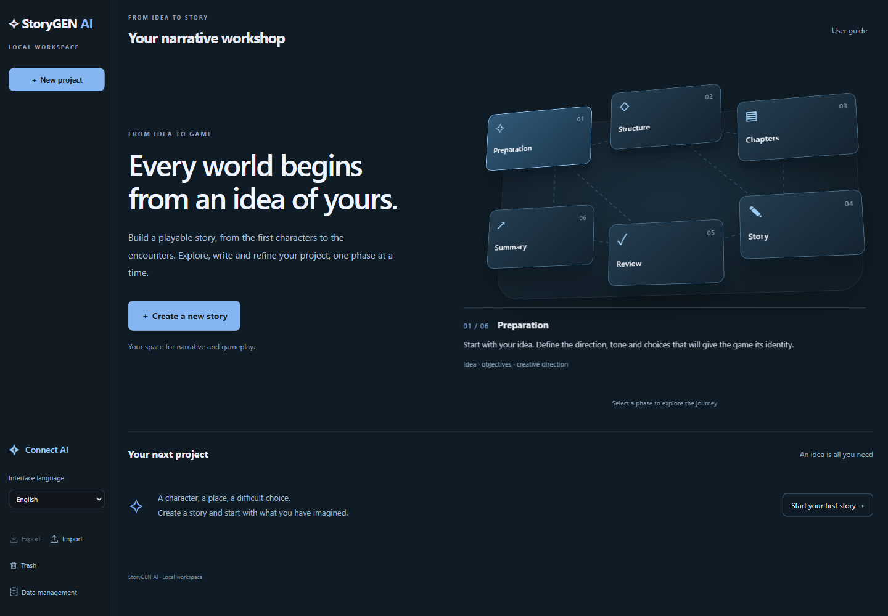
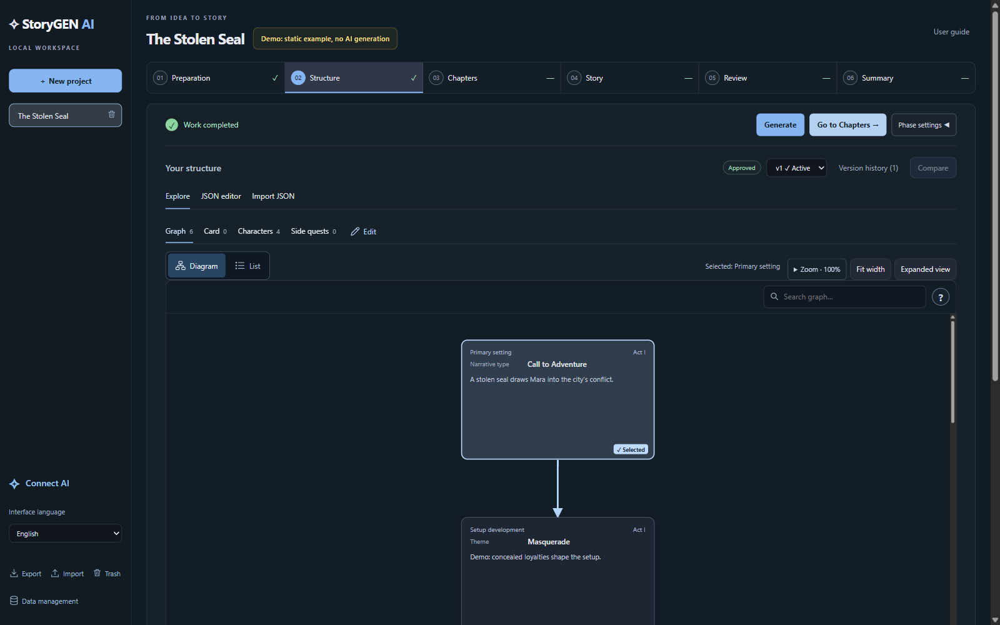
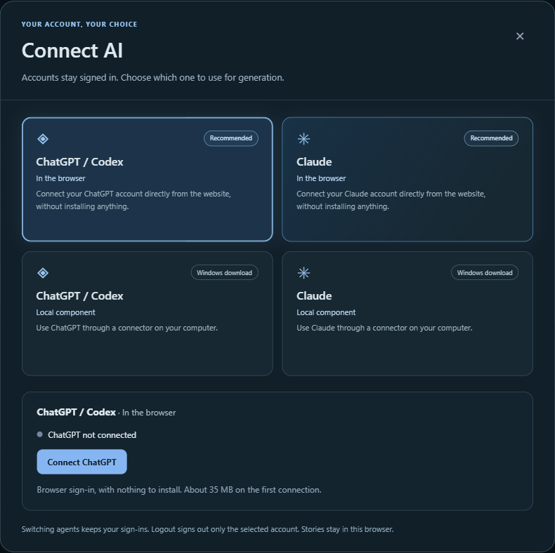

# StoryGEN AI

**Turn a story idea into a structured narrative, one step at a time.**

StoryGEN AI is a browser-based workspace for AI-assisted narrative design. Develop characters, organise story events, plan chapters and encounters, and refine the resulting text while keeping control of your creative decisions.

**[Open the web app →](https://storygenai.federicomaglione.com)** · [Getting started](docs/GETTING_STARTED.md) · [Roadmap](docs/ROADMAP.md)

*Public beta · English and Italian interface · Stories stored in your browser*

## What you can do

- **Build a narrative step by step.** Move from an initial idea to a structure, chapter plan, story, review and summary.
- **Explore the story structure.** Inspect narrative nodes, characters, cards and side quests through dedicated views.
- **Stay involved in the writing.** Review, edit and approve results, or request targeted updates.
- **Keep previous versions.** Compare results, activate an earlier version and inspect the impact of deleting linked versions.
- **Choose your AI connection.** Connect ChatGPT / Codex or Claude in the browser, or use an optional local connector for Windows.
- **Take your work with you.** Export and import projects, save a full archive backup, and create a concept PDF from the summary workflow.

## From idea to story

| Step | What you work on |
| --- | --- |
| **01 · Preparation** | Your premise, creative direction, tone and goals. |
| **02 · Structure** | Narrative events, characters, connections, cards and side quests. |
| **03 · Chapters** | Chapter progression, encounters and gameplay requirements. |
| **04 · Story** | The narrative text, developed from the approved plan. |
| **05 · Review** | Continuity, consistency and opportunities for improvement. |
| **06 · Summary** | A concise overview and a concept document to export and share. |

Review the result of each generation and approve the version you want to use in later steps. StoryGEN supports iteration: you can revisit earlier work rather than accept the first output.

*The structure screenshot uses the built-in static Demo content. It illustrates the interface, not a personalised AI-generated result.*

## Try it

1. Open **[StoryGEN AI](https://storygenai.federicomaglione.com)** in a recent desktop version of Chrome or Edge.
2. Choose **Connect AI** to connect a supported ChatGPT / Codex or Claude account. You can also explore the workflow without connecting an account using Demo mode.
3. Create a project, describe your idea and begin with **Preparation**.
4. Review and approve your results, then continue through the narrative steps.
5. Export your work or save a backup before clearing browser data or moving to another device.

**Demo mode uses predefined, static content.** It does not run AI inference or adapt the example story to your prompt. Personalised generation requires an AI connection with access to the selected model and available quota.

See the **[getting-started guide](docs/GETTING_STARTED.md)** for connections, model settings, versions and backups. A short **User guide** is also available inside the app.

## Connect your account

The connection chooser offers four modes:

| Provider | In the browser | Optional local connection |
| --- | --- | --- |
| **ChatGPT / Codex** | Connect from the website without installing a component. | Download and run the Windows connector. |
| **Claude** | Connect from the website without installing a component. | Download and run the Windows connector. |

You can keep both accounts signed in and switch the active agent. Model access, subscription requirements and usage limits depend on the selected provider and account.

Browser sign-in loads additional runtime components on first use. It can take longer and use more memory than the main workspace, particularly for Claude. See [requirements and current limits](docs/GETTING_STARTED.md#requirements-and-current-limits).

## Your workspace, in your browser

The project archive, story text, versions and workflow state are stored locally in the browser. There is no StoryGEN account required to create a workspace.

When you request AI generation, the relevant story context is sent to your selected AI provider. Local storage does not mean local AI inference. The StoryGEN service delivers the application and relays encrypted provider traffic; it does not host your story database.

Browser storage belongs to the browser profile and website address you use. It does not automatically sync between devices. **Export your projects or a full backup** to keep a separate copy of your work.

## Current scope

The current generation workflow uses a **three-act structure and sequential chapter progression**. Narrative graphs help you design and inspect the structure; they are not yet a complete player-facing branching narrative system.

Alternative dramaturgical structures, state-aware branches and foldback narratives are planned directions, described in the **[roadmap](docs/ROADMAP.md)**. They are not features of the current beta.

## About this repository

This repository presents the project and documents how to use the public web app. It contains the overview, guides, roadmap and screenshots; the application source code is not included here.

Feedback on usability, narrative workflows and reproducible bugs is welcome through [GitHub Issues](https://github.com/Xyon-FS/StoryGenAI/issues). Include the browser, connection mode, step and expected behaviour. Please omit account credentials and private story content.

## Origins and research

StoryGEN AI builds on research into AI-assisted narrative design and human–AI co-creation, and is evolving into a practical workspace for authors and game designers.

[Explore the research and narrative example →](docs/ORIGINS_AND_RESEARCH.md)

Created by **[Federico Maglione](https://federicomaglione.com)** · [GitHub](https://github.com/Xyon-FS)
